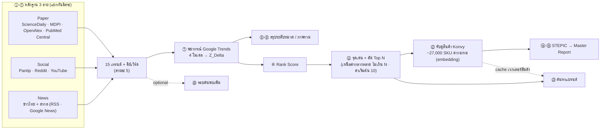

<div align="center">

# Trend Pipeline

**ไปป์ไลน์วิเคราะห์และพยากรณ์เทรนด์ความงามและของใช้ส่วนตัว**
เก็บหลักฐานจาก 3 สาย → พยากรณ์ด้วย Google Trends จริง → จับคู่กับสินค้าในตลาด → รายงานฉบับสมบูรณ์


-orange)


📰 [อัปเดต](CHANGELOG.md) | 🧭 [ภาพรวม](#-ภาพรวม) | ⚙️ [ติดตั้ง](#️-ติดตั้ง) | ▶️ [การใช้งาน](#️-การใช้งาน) | 🐍 [ใช้เป็นไลบรารี](#-ใช้เป็นไลบรารี) | 💾 [ผลลัพธ์และการกู้คืน](#-ผลลัพธ์และการกู้คืน) | 🔁 [ความคลาดเคลื่อน](#-ความคลาดเคลื่อนและข้อจำกัด) | 🛠️ [การพัฒนาต่อ](#️-การพัฒนาต่อ)

</div>

---

## 📰 อัปเดตล่าสุด

ประวัติการเปลี่ยนแปลงทั้งหมดอยู่ที่ **[CHANGELOG.md](CHANGELOG.md)** (25 รายการ) — ล่าสุด 2026-10-21: กติกา Excellent ใหม่: ต้องตรงเทรนด์ top 1% ของหมวด และขายดี (top 20% ของหมวดด้านยอดขาย) ทั้งคู่ - ไม่ขายดีได้สูงสุด Good

> [!NOTE]
> ผลของระบบเป็น **เครื่องมือช่วยตัดสินใจ** ไม่ใช่คำตอบสุดท้าย ส่วนที่ใช้ LLM ให้ผลต่างกันได้ในแต่ละรอบ และการจับคู่สินค้า
> ยังไม่เคยวัดความแม่นเทียบกับป้ายที่คนตรวจ — ดู [ความคลาดเคลื่อนและข้อจำกัด](#-ความคลาดเคลื่อนและข้อจำกัด)

---

## 🧭 ภาพรวม

ระบบทำงานคล้ายทีมวิจัยตลาด: แยกทีมเก็บหลักฐาน 3 สายที่ไม่ปนกัน ให้แต่ละสายสรุปเทรนด์ของตัวเอง แล้วค่อยรวมกันที่ชั้นพยากรณ์
คัดเทรนด์ที่กำลังโต ดูว่าตลาดมีสินค้ารองรับหรือยัง และสรุปเป็นรายงาน — **ตัวเลขตัดสินด้วยกฎตายตัว ส่วน LLM ทำงานด้านภาษา**



### สายหลักฐาน (①-⑤)

ทั้ง 3 สายใช้โครงเดียวกัน ต่างกันแค่แหล่งข้อมูลและภาษาที่ใช้ค้น จึงเทียบกันได้ตรงๆ

| สาย | แหล่งข้อมูล | ตอบคำถาม |
|---|---|---|
| **Paper** | ScienceDaily, MDPI, OpenAlex, PubMed Central | กลไกและเทคโนโลยีอะไรกำลังมา |
| **Social** | Pantip, Reddit, YouTube | ผู้บริโภคเจอปัญหาอะไร พูดถึงอะไร |
| **News** | ข่าวไทย + ข่าวสากล (RSS ใน `config/rss_feeds.json` + Google News) | ตลาด/แบรนด์/กฎเกณฑ์ขยับไปทางไหน |

ขั้นตอนในแต่ละสาย: LLM สร้างคำค้น → รวบรวมบทความ → LLM เลือกชิ้นที่เกี่ยวข้อง → เขียนรายงานพร้อมอ้างอิง `(Ref N)` →
สกัด triplet ทีละเอกสาร **พร้อมประโยคหลักฐานที่โค้ดตรวจว่ามีอยู่จริง** → สร้างกราฟและจัดกลุ่ม (Louvain โหวต 20 รอบ) →
ตั้งชื่อเทรนด์ + ให้คะแนน Longevity → แตกคีย์เวิร์ดสำหรับค้น Google Trends — เก็บ 5 เทรนด์ต่อสาย

### ชั้นพยากรณ์และจัดอันดับ (⑦ ⑧-⑨ ⑥)

- **⑦ พยากรณ์** — ดึง Google Trends ทั่วโลกผ่าน SerpAPI แปลงเป็น z-score รายเดือน พยากรณ์ด้วย 4 โมเดล
  (Holt-Winters, Linear Regression, Random Forest, XGBoost) เลือกโมเดลจากความคลาดเคลื่อนบนช่วง holdout 6 เดือน
  แล้วคำนวณ **Z_Delta** = ค่าเฉลี่ยที่พยากรณ์ − ค่าปัจจุบัน สถานะตั้งด้วยเกณฑ์ตายตัว
  (> 0.8 Major Breakout, > 0.2 Rising, < −0.2 Fading, นอกนั้น Stable)
- **⑧-⑨ สรุประดับหมวด** — รวม Z_Delta เป็นภาพรวมต่อสายและทั้งหมด (เป็นผลสรุป ไม่มีขั้นอื่นอ่านต่อ)
- **⑥ Rank Score** (🆕 2026-09-30, 🆕 2026-10-02 ปีที่ 2, 🆕 2026-10-19 ปีที่ 3) — **คะแนนการเติบโตปีที่ 3** (ระยะสั้น = `common/horizons.SHORT_YEAR`) จาก `growth_score.py`: ความแรง = ค่าเฉลี่ยการค้นหาที่คาดในปีนั้น ÷
  ค่าเฉลี่ย 12 เดือนล่าสุด ผสมอันดับ momentum (การโตปีที่แล้ว) กับ RandomForest ที่ฝึกจากทุกคีย์เวิร์ดในอดีต ให้คะแนนเป็น
  percentile เทียบคีย์เวิร์ดทั้งหมดในรอบ (0.5 = ค่ากลางตลาด) คำนวณปีที่ 1-5 - backtest 2016-2022 ได้ Spearman ≈ 0.40-0.52
  (Z_Delta เดิม −0.20) ไม่มีโบนัสจำนวนสายแล้ว (ใช้ตัดสินกรณีเท่ากัน) ฝึกด้วยข้อมูลถึง `LAST_TRUSTED_MONTH` (มิ.ย. 2025)
  เพราะข้อมูล cat=0 กระโดดตั้งแต่ ส.ค. 2025 **ตอนนี้ใช้โมเดลอย่างเดียว** (`growth_score.BLEND_MOMENTUM = False`) เพราะช่วง
  กระโดดทำให้ momentum เพี้ยน คะแนนเทรนด์ = percentile ของ % ที่คาดของเทรนด์ ระดับกับ % ในรายงานจึงตรงกัน เปิดแบบผสมกลับเมื่อ
  ข้อมูลถึง ก.ค. 2027 (โปรแกรมเตือนให้เอง) กราฟหน้าเทรนด์แสดงระดับที่คาดปีที่ 1-5 พร้อมแถบ 80% จาก backtest (คลาดเฉลี่ย
  6% / 9% / 12% / 16% / 20%) และปรับคะแนน Longevity ของเทรนด์ที่ยืนยันข้ามสาย — **รันหลัง ⑦ เพราะใช้
  ค่าการค้นหารายเดือน (step5a)**

### ชั้นอุปทาน (⑪ ⑫ ⑬)

- **⑪ จุดเด่น + Top N** — เดินตามอันดับ ⑥ ให้ LLM สกัดจุดเด่น (Means-End Chain / JTBD) และจัดประเภทเทรนด์
  ข้ามเทรนด์ประเภทช่องทาง/พฤติกรรมการซื้อ หรือที่ไม่มีข้อความให้จับคู่ แล้วเลื่อนอันดับถัดไปขึ้นมา **แต่หยุดที่ค่ากลางตลาด**
  (เฉพาะเทรนด์ที่คะแนนปีที่ 3 ถึง `GROWTH_LINE` = 0.5) หรือครบ N ถ้าถึงก่อน - **N คือเพดาน จำนวนที่ได้จริงมักน้อยกว่า**
  (รอบ snapshot ตอนที่ยังใช้ปีที่ 2: 15 เทรนด์ ขอ 10 ได้ 6 เทรนด์สินค้า; รอบ 082438 ที่ปีที่ 3 ได้ 8) · ตรวจเพิ่มจนรู้ Top 5 ที่จับคู่ได้ของปีที่ 3 และปีที่ 5
  บันทึกใน `checked_trends` / `extra_profiles` - ⑫ ⑬ ยังอ่านแค่ `profiles`
  ชุด `profiles` นี้คือชุดสินค้าชุดเดียวที่ ⑫ ⑬ และรายงานใช้ร่วมกัน - เทรนด์เหนือเส้นที่ ⑪ ข้าม (ช่องทาง/ข้อมูลไม่พอ) อยู่ใน
  `excluded_trends` และรายงาน ⑯ เอามาทำหน้าอธิบาย (ดูหัวข้อ "รายงาน PDF (⑯)")
- **⑫ จับคู่สินค้า** — แปลงจุดเด่นเทรนด์ (`query`) และข้อมูลสินค้า Konvy (สินค้าความงาม ~27,000 SKU) (`passage`) เป็นเวกเตอร์ 2,048 มิติ
  เรียงด้วย cosine similarity เก็บ 15 อันดับแรกต่อเทรนด์ และให้ LLM เขียนเหตุผลสั้นๆ ให้ 5 อันดับแรก
  และแยกหมวด (`by_category`, ไม่ใช้ LLM): ดูว่าสินค้า 1% แรกที่ใกล้ที่สุดอยู่หมวดไหน (**Level 2 ของ Euromonitor** ตาม
  `product/product_category.csv` และตลาดกรองเหลือ **L1 = Beauty and Personal Care** ~8,800 SKU) เก็บ 4 หมวดที่มีมากสุด หมวดละ 3 ชิ้น
  (หมวดที่มีสินค้าใน 1% นั้นไม่ถึง 3 ชิ้นไม่ได้คอลัมน์ ถ้าเหลือไม่ถึง 4 หมวด หมวดที่ใหญ่ที่สุดแตกตามชนิดสินค้า Level 4 เช่น "Skin Care · Serum") -
  รายงาน PDF ใช้ทำหน้าสินค้า (หมวดของสินค้าแต่ละชิ้นจัดโดย LLM ล่วงหน้า ดู `product/classify_products_llm.py`)
  รอบที่รันก่อนมีการแยกหมวด เติมได้ด้วย `validate_at_scale_nvidia.py --categories-only` (NVIDIA เทรนด์ละ 1 ครั้ง ไม่แตะผลเดิม)
- **⑬ ค้นหาแบรนด์** — ดูว่าสินค้าของแบรนด์ที่ระบุอยู่ตรงไหนของแต่ละเทรนด์ (Top 5 ต่อเทรนด์)

### รายงาน (⑭-⑮)

วิเคราะห์แรงขับ 6 ด้าน (STEPIC: Society, Technology, Environment, Policy, Industry, Creativity) สังเคราะห์รวม
(ข้อมูลพยากรณ์ที่ป้อนเข้า STEPIC เป็นการเติบโตที่คาดต่อเทรนด์จาก ⑥ - ไม่ใช่ z-score) แล้วประกอบเป็น Master Report ที่มีรายงาน 3 สาย ผลพยากรณ์ จุดเด่นเทรนด์ และสินค้าที่จับคู่ได้ เรียงตามอันดับของ ⑪ (การเติบโตที่คาดในปีที่ 3)

```bash
python tool/phase5_report/run_stepic_report.py --from-saved    # ประกอบ md ใหม่จากผล STEPIC ที่บันทึกไว้ ไม่เรียก LLM
python tool/phase5_report/run_stepic_report.py --reintegrate   # ใช้ผล 6 มิติเดิม เรียก LLM เฉพาะขั้นสังเคราะห์รวม
python tool/phase5_report/run_stepic_report.py --narrative     # ใช้ผล STEPIC เดิมทั้งชุด เรียก LLM เฉพาะข้อความต่อเทรนด์
```

### รายงาน PDF (⑯)

รายงานแบบสไลด์ 16:9 (แบบรายงาน Trend Hunter) **2 ไฟล์: ภาษาอังกฤษและภาษาไทย** เนื้อหาและจำนวนหน้าเหมือนกัน ประกอบจากผลทุกขั้นของรอบ: ปก, Report Summary, Takeaway,
Market Overview (ค่ากลางที่คาดปีที่ 3 / ปีที่ 5 + บทสรุปตลาด + จำนวนเทรนด์ที่สูงกว่าระดับตลาด "8 จาก 15"), Top 5 ระยะสั้น (ปีที่ 3) เทียบระยะยาว (ปีที่ 5)
เลือกจาก**ทุกเทรนด์**, ภาพรวมทุกเทรนด์ **ครบทุกเทรนด์ตั้งต้น** ในหน้าเดียวที่มีทั้ง CAGR (เฉลี่ยต่อปี - แท่งกราฟ) และ YoY (เทียบปีก่อนหน้า - ตัวเลข) ต่อปี
(ปีที่ 1-5 แบ่งหัวเป็นระยะสั้น = ปี 1-3 และระยะยาว = ปี 4-5 เส้นประที่ระดับตลาด - หน้าแบบสะสมเลิกแล้ว, หน้า CAGR / YoY แยกเลิกแล้วตั้งแต่ 2026-10-19), STEPIC, Personas,
Trend Drivers (heatmap เทรนด์ x แรงขับ STEPIC 6 ด้าน + persona 3 กลุ่ม),
แล้ว**หน้ารายละเอียดเทรนด์ละ 2 หน้า เฉพาะเทรนด์เหนือค่ากลางตลาดในปีที่ 3** (เทรนด์ใต้เส้นอยู่เฉพาะในตารางและกราฟภาพรวม)
(หน้า 1: % ที่คาดปีที่ 3 / ปีที่ 5 เป็นเฉลี่ยต่อปี / 12 เดือนที่ผ่านมา / แหล่งที่ยืนยัน + Longevity, กราฟพยากรณ์ปีที่ 1-5 (🆕 2026-10-19
เส้นสีน้ำเงิน = เติบโตเฉลี่ยต่อปี แท่งเทา = เปลี่ยนเทียบปีก่อนหน้า ตัวเลข YoY อยู่ใต้ชื่อปี - แทนกราฟประวัติการค้นหา 3 ปี + แถบ 80%
ซึ่งยังใช้ในหน้าวิธีการ `charts.history_chart_svg`), Means-End 3 บรรทัด (จุดต่าง / ประโยชน์ / ความรู้สึก)
+ คำถาม Workshop; หน้า 2: สินค้า Konvy ที่ใกล้ที่สุดแยกตามหมวดหลักของเทรนด์ และช่วงราคาต่อปริมาณ
- รอบที่ผล ⑫ ยังไม่มีข้อมูลหมวดใช้หน้าสินค้าแบบเดิม 5 ชิ้น) · 🆕 2026-10-15 เทรนด์ที่ ⑪ ตัดสินแล้วว่าไม่พบสินค้าในตลาด
(ช่องทาง/พฤติกรรมการซื้อ หรือข้อมูลไม่พอ) **ถูกเอาออกจากรายงาน ⑯ ทั้งเล่ม** - ไม่มีหน้า ไม่มีแถวในตารางภาพรวม CAGR + YoY ไม่นับ
ในจำนวนเทรนด์และภาพรวมตลาด (`report_data.SHOW_NO_PRODUCT_TRENDS = False`; True = กลับไปแบบ 2026-10-14 ที่มีหน้า "ไม่พบสินค้าในตลาด") ·
จำนวนเทรนด์ที่มีหน้าจึงไม่ใช่ N ของ ⑪ ตรงๆ (รอบ snapshot: 15 เทรนด์ -> 13 เทรนด์ในรายงาน, 6 หน้ารายละเอียด)
และภาคผนวกวิธีการ — เฉพาะเทรนด์ ไม่มีหน้าเทียบแบรนด์ (⑬ แยกจาก PDF) ตัวเลขทุกตัวมาจากไฟล์ผลรัน ไม่แสดงว่าเทรนด์มาจากสายไหน
**ระยะสั้น/ระยะยาว** = % การค้นหาที่คาดปีที่ 3 / ปีที่ 5 เทียบ 12 เดือนล่าสุด (🆕 2026-10-19 ระยะสั้น 2 -> 3 ปี) (🆕 2026-10-02 เดิมเป็น 4 ระดับ "เร็ว/ช้ากว่าตลาด"
ของปีที่ 1 / 3) สีแท่ง = คะแนนเทียบค่ากลางของคีย์เวิร์ดทั้งหมดในรอบ (เหนือ/ใต้) - 🆕 2026-09-30 ไม่มี Z_Delta, กราฟพยากรณ์
z-score และกลุ่มกลยุทธ์ Invest / Harvest / Build / Watch แล้ว Longevity (70+ / 55-69 / 40-54 / < 40) ยังแสดงในหน้าเทรนด์
เป็นข้อมูลความยั่งยืนประกอบ และที่หลักฐานไม่พอแสดง "Not enough evidence" แยกต่างหาก
LLM ใช้แค่งานภาษา: ฉบับอังกฤษเรียบเรียงจุดเด่นเทรนด์ (⑪ เป็นภาษาไทย) เป็นภาษาอังกฤษ ฉบับไทยเขียนข้อความต่อเทรนด์เป็นภาษาไทย
และแปลบทวิเคราะห์ภาษาอังกฤษ (Takeaway, STEPIC, Personas, เหตุผลจับคู่สินค้า ฯลฯ) ย่อโปรไฟล์ ⑪ เป็น Means-End 3 บรรทัด (ได้ทั้ง 2 ภาษา
ในการเรียกเดียว - ไม่ผ่านการตรวจใช้ย่อหน้า Trend/Insight แทน) - ทั้งหมด cache ไว้ รันสร้าง PDF ซ้ำจึงไม่เรียก LLM อีก
**ยกเว้น 1 จุดที่ LLM ตัดสิน:** หน้า Trend Drivers ให้ LLM บอกระดับความเชื่อมโยง 0/1/2 ต่อช่อง (`trend_links.py`) พร้อมหลักฐาน
ช่องที่ไม่มีหลักฐานถูกปรับเป็น 0 ตัวเลขอื่นในรายงานไม่ใช้ผลนี้ และไม่มี LLM ก็ไม่มีหน้านี้
ฉบับไทยคงชื่อเทรนด์ คีย์เวิร์ดค้นหา และชื่อแบรนด์/สินค้าเป็นภาษาอังกฤษ ปีเป็น ค.ศ. ข้อความตายตัวของทั้ง 2 ภาษาอยู่ที่
`tool/phase6_pdf_report/i18n.py`
โลโก้และชื่อบริษัทตั้งที่ `config/report_branding.json`

### รายงานแบรนด์ x เทรนด์ (⑰)

รายงาน **1 ไฟล์ต่อ 1 แบรนด์ลูกค้า** (อังกฤษ + ไทย, 16 หน้า) แยกจากรายงานเทรนด์ สร้างต่อจาก ⑬ ของแต่ละแบรนด์ในลูปถามแบรนด์
(ทั้งโหมด 1 และโหมด 2): ปก → สรุปผู้บริหาร (สินค้าของแบรนด์บน Konvy + จำนวนเทรนด์แต่ละระดับ + ประเด็นสำคัญ 3 ข้อ) →
Trend Fit Matrix (แรงส่งของเทรนด์ x อันดับของสินค้าที่ใกล้ที่สุดของแบรนด์ แบ่ง 4 ช่อง: ปกป้อง / สร้างใหม่ / รักษาไว้ / เฝ้าดู) →
ตารางภาพรวม → เทรนด์ละ 1 หน้า (ตาราง **top 5 สินค้าใกล้เทรนด์ที่สุดของตลาดทั้งหมด** + สินค้าของแบรนด์ 1-3 ชิ้นต่อท้ายพร้อม
**อันดับในตลาด** ถ้าสินค้าแบรนด์ติด top 5 จะไฮไลต์แถวนั้นในตาราง; top 5 มาจากผล ⑫ ชุดเดียวกับรายงานเทรนด์ อันดับสินค้าแบรนด์มาจาก ⑬ -
จำนวนแถวตั้งที่ `market_top_n` / `products_per_trend` ใน `config/brand_report.json`; เทรนด์ที่ไม่พบสินค้าในตลาด
ไม่ถูกนำมาเทียบ - ตั้งแต่ 2026-10-15 ถูกตัดตั้งแต่ ⑯ แล้ว `report_data.product_trends` จึงเป็นแค่ตัวกันซ้ำ) → โอกาสพัฒนาสินค้า (เทรนด์ในช่อง สร้างใหม่) → ภาคผนวก

**ระดับความพร้อมวัดจากอันดับจริงในตลาด** ของสินค้าที่ดีที่สุดของแบรนด์ (นำตลาด 1-25, แข่งขันได้ 26-100, ตามหลัง 101-500,
ช่องว่าง เกิน 500 หรือไม่มีสินค้า - ปรับได้ที่ `config/brand_report.json`) ไม่ใช้ tier ของ ⑬ เพราะ tier วัดจาก percentile
ของสินค้าที่ดีที่สุดซึ่งแทบเกิน 67 เสมอเมื่อแบรนด์มีหลาย SKU (รอบ 082438 ได้ "ตามทัน" ครบ 50/50 คู่) - เกณฑ์ตั้งขึ้นเอง
ยังไม่ได้เทียบกับการตัดสินของคน LLM ใช้แค่แปลเหตุผลจับคู่สินค้าของแบรนด์เป็นไทย (cache ต่อแบรนด์) ข้อความเทรนด์ใช้ cache ของ ⑯

### รายงานหมวด x ระดับราคา (⑱) — รวมเข้า ⑰ แล้ว (🆕 2026-10-14)

**⑱ ไม่ถูกสร้างแยกอีก** - หน้าสินค้าต่อเทรนด์ของ ⑰ (หน้าที่ 2 ของแต่ละเทรนด์) ใช้หน้าตาเดียวกับหน้าเทรนด์ของ ⑱ เดิม: 3 กลุ่มราคาต่อปริมาณ (ต่ำ/กลาง/สูง) แต่ละกลุ่มมี top 5 + สินค้าที่ดีที่สุดของแบรนด์ พร้อมอันดับ / % แรกของกลุ่ม / อันดับทั้งร้าน (ข้อมูลจาก `brand_category_data.build_category_context` ชุดเดียวกับที่ ⑱ ใช้ - `category_fit` ของ ⑬) ข้อความ/CSS ของหน้านั้นอยู่ใน `brand_category_i18n.trend_page_strings` (คีย์ `cp_*`) และ `templates/brand_trend_page.css`; ตารางภาพรวมหมวด x กลุ่มราคาและสรุปผู้บริหารของ ⑱ ไม่ได้ย้ายมา. สคริปต์ `build_brand_category_report.py` ยังอยู่ (สร้าง ⑱ แยกเองได้) แต่ `main.py` ไม่เรียกแล้ว; ไฟล์ ⑱ เดิมของรอบ ที่เคยสร้างย้ายไป `output/_backups/brand_report_merge_20261014/<รอบ>/`. ข้อความด้านล่างเป็นประวัติของ ⑱ เดิม

🆕 2026-10-05 รันลูกค้า 1 ครั้งได้ **2 รายงาน** (ฉบับละ อังกฤษ + ไทย): ⑰ เทียบสินค้ากับตลาดทั้งร้าน และ ⑱ เทียบ**ในหมวดของเทรนด์ แล้วแบ่งตามช่วงราคาของแบรนด์เอง**
(ข้อเสนอแนะ: ซีรัมของแบรนด์ไม่ควรต้องแข่งกับกันแดดหรือเครื่องสำอางในอันดับเดียว) สร้างต่อจาก ⑰ ในลูปถามแบรนด์ทั้งสองโหมด:
ปก → สรุปผู้บริหาร (สินค้าแบรนด์แยกหมวด + จุดแข็ง + เทรนด์ที่แบรนด์ไม่มีสินค้าในหมวด) → ตารางทุกเทรนด์ (หมวดหลัก, อันดับในหมวด, อันดับในแต่ละระดับราคา) →
เทรนด์ละ 1 หน้า (3 ระดับราคา: top 5 ของ "หมวด ∩ ระดับราคา" + สินค้าที่ดีที่สุดของแบรนด์ในระดับนั้นพร้อมอันดับ เช่น "#11 จาก 1,151 (1% แรก)" และอันดับในตลาดทั้งร้าน) → ภาคผนวก

วิธีคิด (โค้ดอยู่ที่ `phase3_supply_layer/price_tiers.py` เรียกจาก ⑬ ใช้ similarity ชุดเดียวกับที่ ⑬ คำนวณอยู่แล้ว ไม่เรียก LLM เพิ่ม):
1. เทรนด์ → หมวด L2 หลัก = หมวดที่มีสินค้าใน 1% แรกของตลาดมากที่สุด (ตรรกะเดียวกับ `category_breakdown.py` ของ ⑫)
2. สินค้าของแบรนด์ในหมวดนั้น → แบ่ง**ราคาของแบรนด์เอง**เป็น ≤ 3 ระดับเท่าๆ กัน (แต่ละระดับมีสินค้าของแบรนด์ ≥ 2 ชิ้น เส้นแบ่งอยู่กึ่งกลางระหว่างราคาที่ติดกัน)
   ช่วงราคารวมจำกัดที่ [ต่ำสุด, สูงสุด] ของแบรนด์ — สินค้าตลาดที่ถูก/แพงกว่านี้ไม่ถูกเทียบ
3. อันดับในระดับราคา ≤ อันดับในหมวด ≤ อันดับในตลาดทั้งร้านเสมอ (กลุ่มเทียบเล็กลง) แบรนด์ที่ไม่มีสินค้าในหมวดหลักแสดง top 5 ของหมวดทั้งช่วงราคา + ข้อความแจ้ง
ข้อจำกัด: ชุดของขวัญ/เซ็ตรวมอยู่ในหมวด (ดันระดับราคาสูง), สินค้าไม่มีราคาไม่ถูกเทียบ, L2 กว้าง (Skin Care รวมซีรัม/มาสก์/คลีนเซอร์), แบรนด์ที่มีสินค้าในหมวดน้อยได้ 1-2 ระดับ
(ถ้าสินค้าทุกชิ้นราคาเดียวกัน ระดับเดียวเทียบเฉพาะสินค้าราคานั้น)

ผล ⑬ ของรอบเก่าที่ยังไม่มี `price_tiers` เติมย้อนหลังได้โดยไม่รัน ⑬ ทั้งชุด (ไม่เรียก LLM, embed เทรนด์ใหม่ ~1 เรียก/เทรนด์) แล้วสร้างรายงาน:

```powershell
python tool/phase3_supply_layer/run_brand_coverage.py --tiers-only --brand Mizumi    # เลือกรอบด้วย TREND_RUN_ID; ไม่ใส่ --brand = ทุกแบรนด์ในรอบนั้น
python tool/phase6_pdf_report/build_brand_category_report.py --run <รอบ> --brand Mizumi
```

### รายงานส่วนแบ่งตลาด (⑲) — 🆕 2026-10-12 (Phase 0-5 ครบ ได้ PDF อังกฤษ + ไทย)

รายงานที่ 3 ว่าด้วย**ภาพรวมตลาด** (ไม่แยกแบรนด์ลูกค้า) และ**ปัจจัยที่ทำให้ส่วนแบ่งเปลี่ยน** ไม่ขึ้นกับรอบเทรนด์ ข้อมูลมาจาก `tool/product/euromonitor.xlsx` (Euromonitor Thailand
Beauty and Personal Care, edition 2026) และ `tool/product/FDA.xlsx` (ใบจดแจ้ง อย.) ผลอยู่ในโฟลเดอร์ `output/market_share_<วันเวลา>/` (โหมด 2/3 ของ `main.py`
ไม่แสดงโฟลเดอร์นี้เพราะไม่มีผล ⑪) ลำดับงาน: ข้อมูล → **คำนวณข้อเท็จจริง (โค้ด)** → ตั้งคำถามตามกฎ → ค้นเว็บ (cache + เก็บ URL) → LLM สรุปพร้อมอ้างอิง → ตรวจตัวเลข/แหล่ง → รายงาน

กติกาที่เจ้าของงานเลือก: หน้าภาพรวมใช้**ปัจจัยเป็นแกน** (ปัจจัย / ตลาดเปลี่ยนอย่างไร / แบรนด์ที่เกี่ยวข้อง / แหล่งอ้างอิง) **ไม่บอกว่าแบรนด์ไหนชนะหรือแพ้** - แบรนด์เรียงตามขนาดส่วนแบ่ง
ไม่ใช่ตามการเปลี่ยนแปลง ไม่ใช้สีเขียว/แดงบอกขึ้นลง; อ้างอิง Euromonitor ที่หน้าสุดท้าย

Phase 0-1 (ไม่เรียก API):
- `market_data.py` โหลดเป็นตารางยาว + cache parquet ใน `output/_checkpoints/market_*.parquet` (ผูกกับขนาด/เวลาแก้ไขของไฟล์ต้นทาง - ครั้งแรก ~3 นาที หลังจากนั้น ~3 วินาที)
  ส่วนแบ่งแบรนด์ใช้ sheet GBNL (ย้อนประวัติตามเจ้าของล่าสุด), ช่องทางขายใช้ระดับใบ (รวมได้ 100%), หมวด อย. แปลงเป็นหมวด Euromonitor ได้ 5 หมวด (Skin/Sun Care,
  Bath and Shower, Hair Care, Colour Cosmetics) ที่เหลือ 21% เป็น "Uncertain"
- `market_facts.py` → `phase7_market_facts.json`: ขนาดตลาดและอัตราโต (ราคาปัจจุบัน / ตัดเงินเฟ้อ / ช่วงคาดการณ์ถึง 2030), แบรนด์ใหญ่ต่อหมวด, Others / top 5,
  ช่องทางขาย, สัดส่วน premium, ใบจดแจ้ง อย. ต่อปี + สัดส่วนนำเข้า + แบรนด์ใหม่ และ**ปัจจัยของหมวด** 4 ชนิดที่วัดจากข้อมูลได้
  (`channel_shift` / `concentration` / `premium_shift` / `launch_activity` เกณฑ์ใน `config/market_report.json`)

ข้อควรระวังที่โค้ดจัดการแล้ว:
- **ปีตั้งต้น 2019 ไม่ใช่ 2020** - ปี 2020-2021 (COVID) ผิดแนว (Others ของ Colour Cosmetics 27% ปี 2019 → 16% ปี 2020 → 43% ปี 2025)
- **แบรนด์ที่หายจากรายชื่อมี 2 แบบ** - รวมเข้าแบรนด์อื่นของเจ้าของเดียวกันที่มีคำในชื่อร่วมกัน (Johnson's → Johnson's Baby 2023, The History of Whoo → The Whoo)
  เทียบส่วนแบ่งแบบรวมทั้งสองปี / หรือ Euromonitor เลิกแยก (Fragrances ปี 2023 เลิก 8 แบรนด์) ส่วนนี้หักออกจากการเพิ่มของ Others (`others_change_excl_dropped_pp`)
  ไม่นับเป็นตลาดกระจายตัว
- แบรนด์ที่ "เพิ่งมีชื่อ" ใน Euromonitor อาจเคยอยู่ใน Others มาก่อน - ใช้ปีแรกที่พบใน อย. (`fda_first_year`) ช่วยดูว่าใหม่จริงไหม
- จำนวนใบจดแจ้งไม่สอดคล้องกับส่วนแบ่งของแบรนด์ใหญ่ (Eucerin ออกสินค้าน้อยลง 81 → 46 ต่อปี แต่ส่วนแบ่งเพิ่ม) - ใช้ อย. บรรยายแบรนด์ใหม่และกิจกรรมของหมวดเท่านั้น

Phase 2 (ไม่เรียก API) - `factors.py` = **รายการปัจจัยแบบชุดปิด** 13 ตัว (วัดจากข้อมูล 4: ช่องทางขาย / แบรนด์เล็กและแบรนด์ใหม่ / พรีเมียม / การออกสินค้าใหม่;
มีแค่หลักฐานจากเว็บ 8: จุดยืนของแบรนด์ / การตลาด / จุดขายของแบรนด์ / ราคาและโปรโมชัน / สินค้าและนวัตกรรม / การเปลี่ยนแปลงของบริษัท / ความเชื่อมั่น /
พฤติกรรมผู้ซื้อ; + "อื่นๆ" รอคนตรวจ) LLM ใน Phase 4 จัดหลักฐานเข้าได้แค่รายการนี้ - `market_questions.py` → `phase7_market_questions.json` เลือกเรื่องตามกฎ
(เกณฑ์ `*_story_min_*` ใน config) ได้คำถามระดับตลาด (e-commerce ทั้งตลาด, ช่องทางที่เปลี่ยน, แบรนด์เล็ก, พรีเมียม, สินค้านำเข้าใน อย.) + ระดับแบรนด์
(6 หมวดใหญ่ หมวดละ 3 แบรนด์ที่ส่วนแบ่งเปลี่ยนมากที่สุด) คำถามละ 2 คำค้น (อังกฤษ + ไทย) - คำค้นไทยใส่ชื่อการค้าภาษาไทยจาก อย. ด้วย (`"Mistine" OR "มิสทิน"`)
เพราะข่าวไทยเขียนชื่อไทย; ถ้อยคำเป็นกลาง ("อะไรเกี่ยวข้องกับการเปลี่ยนแปลง...") รอบแรก: 34 คำถาม = ~68 search

Phase 3 (**เสียโควตา SerpAPI**) - `market_search.py` → `phase7_market_evidence.json`: ค้น Google ผ่านตัวสลับคีย์ (`common/serpapi_keys.POOL`)
จำกัดผลตั้งแต่ 1 ม.ค. ของปีตั้งต้น + ตัดเว็บโซเชียล/ร้านค้าด้วย `-site:` (ทดลองจริง: ไม่ตัด = หน้าแรก Shopee + โพสต์ Facebook 17/20 รายการ) แล้วดึงเนื้อหาเต็ม
คำถามละ 6 หน้า (requests + BeautifulSoup, PDF ด้วย pypdf ไม่ใช้ Apify) พร้อมวันที่เผยแพร่จาก meta ของหน้า - ผลค้นหาและหน้าเว็บ cache ข้ามรอบใน
`output/_checkpoints/market_search/` และ `market_pages/` (คำค้นเดิมไม่เสียโควตาซ้ำ) ก่อนค้นนับคำค้นที่ยังไม่มีใน cache เทียบโควตารวมทุกคีย์ ไม่พอ = หยุด
หมายเหตุ: วันที่ในผลค้นหาของ Google ไทยเป็น พ.ศ. แม้ค้นภาษาอังกฤษ (`Oct 7, 2565 BE`, `22 ต.ค. 2567`) - Phase 4 แปลงก่อนเทียบช่วงเวลา
ต่อคำถาม 4 คำค้น: เว็บ + **ข่าว Google News** (`tbm=nws`) อย่างละอังกฤษ/ไทย - เพิ่มข่าวเพราะรอบแรกที่มีแต่เว็บ LLM ไม่พบคำอธิบาย 20 จาก 34 คำถาม
(หลักฐานเป็นหน้าขายของ/โปรโมชัน/หน้าที่แค่มีคำว่า "be nice") ข่าวเรียงก่อนเว็บ คำค้นข่าวของแบรนด์ใช้แค่ชื่อแบรนด์ (`"Mistine" Thailand` / `"Mistine" OR "มิสทิน"`)
ผลค้นหาที่ขอซ้ำเมื่อไม่ได้ผล (ไม่จำกัดวันที่) ติด `date_filter: false` - คำค้นข่าว**ไม่ใส่ `-site:`** (SerpAPI ค้างจนหมดเวลาทุกครั้งที่คำค้นข่าวมี `-site:`)
และ `common/serpapi_keys.py` ตั้ง timeout 60 วินาทีเอง (ค่าเริ่มต้นของ library `serpapi` = 60000 ที่ `requests` อ่านเป็นวินาที ≈ 16 ชั่วโมง) ล้ม = error ชั่วคราว ไม่ cache

Phase 4 (เรียก LLM - GLM-5 ผ่าน Bedrock เหมือน ⑯/⑰) - `market_synthesis.py` → `phase7_market_findings.json`: ต่อคำถาม LLM อ่านหลักฐาน (ไม่เกิน 12 ชิ้น;
ตัดชิ้นที่เก่ากว่าปีตั้งต้น / เว็บร้านค้า-โซเชียล / คำถามแบรนด์ที่ไม่มีชื่อแบรนด์ เนื้อหาเต็มเหลือเฉพาะบรรทัดที่มีคำสำคัญ) แล้วตอบ findings = ปัจจัย (ชุดปิด) +
`relevance` (`direct` = แหล่งพูดถึงยอดขาย/ส่วนแบ่ง/ช่องทางในไทยตรงๆ, `background` = จริงแต่ไม่เชื่อมกับยอดขาย) + ประโยคอังกฤษ/ไทยที่บอกว่าใครพูด
("ข่าวรายงานว่า" / "แบรนด์ระบุว่า" - ห้ามเขียนคำโฆษณาของแบรนด์เป็นข้อเท็จจริง) + rid ที่อ้าง + ข้อความที่ยกมาตรงตัว **โค้ดตรวจทุก finding**: ปัจจัยอยู่ในรายการ,
rid มีจริง, ข้อความที่ยกมาอยู่ในหลักฐานที่อ้าง (ไม่สนช่องว่าง - ภาษาไทยเว้นวรรคไม่ตายตัว), ตัวเลขทุกตัวมีในข้อเท็จจริงหรือหลักฐาน (แปลง พ.ศ./ค.ศ. ได้), ภาษาถูก,
ไม่มีคำว่าชนะ/แพ้และคำต้องห้าม - ไม่ผ่านตัดทิ้งเฉพาะข้อนั้น (เหตุผลอยู่ใน `rejected`) ไม่มี finding = `no_evidence` (รายงานบอกว่ายังไม่พบคำอธิบาย ไม่เดา)
`by_factor` = ต่อปัจจัย: คำถาม / แบรนด์ (เรียงตามตัวอักษร) / หมวด / จำนวนแหล่ง / จำนวน direct - ใช้ทำหน้าภาพรวมแบบ A; cache ผูกกับ hash ของข้อมูลที่ส่ง

Phase 5 (ไม่เรียก API) - `build_market_report.py` → `phase7_market_report.pdf` / `phase7_market_report_TH.pdf` (+ `phase7_market_report_context.json`)
ระบบ PDF เดียวกับ ⑯/⑰/⑱ (Jinja2 → Playwright Chromium 16:9, branding เดียวกัน, `style.css` + `brand.css` + `templates/market.css`) หน้า: ปก (ตัวเลขหลัก 4 ช่อง) → สรุป
(ประเด็นสำคัญสร้างจากตัวเลขด้วยโค้ด) → มูลค่าตลาดแยกหมวด → **ภาพรวมปัจจัยแบบ A** (ปัจจัย / สิ่งที่เห็น: ตัวเลขจากข้อมูลหรือ finding แรก / แบรนด์ A-Z / จำนวนแหล่ง)
(แสดงเฉพาะข้อ direct - ปัจจัยที่มีแต่ข้อพื้นหลังเขียนว่ายังไม่เกี่ยวกับยอดขายในไทย) → **ปัจจัย 2 ต่อหน้า** (ตัวเลขจากข้อมูล + finding ไม่เกิน 4 ข้อ คำถามระดับตลาดก่อน
direct ก่อน) → **แบรนด์ 3 ต่อหน้า** (กราฟส่วนแบ่งรายปีย่อ สีเดียว + บริษัท/กลุ่มราคา/ใบจดแจ้ง อย. + finding ที่หนักแน่นที่สุด 3 ข้อ) → วิธีการ + การเปลี่ยนแปลงที่ยังไม่พบ
คำอธิบาย → แหล่งข้อมูล 3 คอลัมน์ (เลข [n] ตามลำดับที่ใช้ครั้งแรก ชื่อโดเมนกดเป็นลิงก์ได้ URL เต็มอยู่ใน context JSON) → **แหล่งข้อมูลและลิขสิทธิ์ (อ้างอิง Euromonitor
หน้าสุดท้าย)** - ข้อที่ไม่ได้แสดงบอกเป็น "แสดง k ข้อที่หนักแน่นที่สุดจาก n ข้อ" (ทุกข้ออยู่ใน `phase7_market_findings.json`) ข้อความตายตัวอยู่ใน `market_i18n.py`
(ชื่อหมวด/แบรนด์คงอังกฤษ ปี ค.ศ.) ก่อนพิมพ์ตรวจภาษาด้วยกติกาของ `lint_report_language.py` + คำว่าชนะ/แพ้ (ยกเว้นหน้าวิธีการ) มี ERROR = ไม่สร้าง PDF
รอบแรก 40 หน้าต่อภาษา -> เจ้าของงานขอลด (2026-10-12) เหลือ **20 หน้า** แหล่งอ้างอิง 78 ชิ้น
ข้อจำกัด: ข้อความไทยของ LLM อาจพิมพ์ผิด (เช่น "เหมือนเคือ") ตัวตรวจด้วยโปรแกรมจับไม่ได้ - ควรให้คนอ่านทวนก่อนส่ง

```powershell
python tool/phase7_market_report/market_facts.py                   # รอบใหม่
python tool/phase7_market_report/market_facts.py --run <รอบ>        # เขียนทับข้อเท็จจริงของรอบเดิม
python tool/phase7_market_report/market_questions.py                # คำถาม + คำค้นของรอบ market_share_* ล่าสุด (ตรวจไฟล์ก่อนค้นจริง)
python tool/phase7_market_report/market_search.py --dry-run         # จำนวน search ที่ต้องจ่ายจริง + โควตาที่เหลือ
python tool/phase7_market_report/market_search.py                   # ค้นจริง (--max-searches N = เพดาน)
python tool/phase7_market_report/market_synthesis.py --only q18 q20   # LLM สรุปบางคำถามก่อน (ดูคุณภาพ) แล้วค่อยรันทั้งชุด
python tool/phase7_market_report/market_synthesis.py                # ทั้งชุด (--refresh = ไม่ใช้ cache)
python tool/phase7_market_report/build_market_report.py             # PDF อังกฤษ + ไทย (--lang th / --keep-html)
pytest tool/tests/test_market_facts.py tool/tests/test_market_questions.py tool/tests/test_market_search.py tool/tests/test_market_synthesis.py tool/tests/test_market_report.py -v
```

### ส่งออกให้ LLM (⑳) — 🆕 2026-10-26

ส่งต่อผลของรอบให้ LLM ทำงานอื่นนอกจากรายงาน (เขียนอีเมลเสนอขาย สรุปให้ทีม ถามตอบ จัดกลุ่มลูกค้า) - **อ่านไฟล์ของรอบอย่างเดียว ไม่แตะรายงาน ไม่เรียก LLM/API** รันซ้ำได้ (ผลเดิมถูกเขียนทับ)
**`main.py` รันให้อัตโนมัติ 1 ครั้งหลัง ⑰ ของทุกแบรนด์ในรอบ** (โหมด 1/2/3 ; ข้ามเมื่อไม่ได้รัน ⑰ คือไม่มีแบรนด์หรือใช้ `--skip-pdf` ; ไม่บังคับ พังแล้วไปต่อ) หรือรันเองตามคำสั่งด้านล่าง
ต้องมี `phase6_report_context.json` (⑯) และ `phase6_brand_context_<แบรนด์>.json` (⑰ ของแต่ละแบรนด์) ; ไม่มีผลแบรนด์ = ได้เฉพาะตารางเทรนด์ (รันเอง)

ผลลัพธ์ที่ `<รอบ>/llm_export/`: `meta.json` (นิยามเกรด คำอธิบายทุกคอลัมน์ ข้อควรระวังความน่าเชื่อถือของพยากรณ์ - ให้ LLM อ่านก่อน) ·
`briefs/<แบรนด์>.json` (สรุปต่อลูกค้า อ่านจบในตัว ใส่ใน prompt ได้ตรงๆ ราว 20 KB; ช่องไม่มีค่าถูกตัดออก) ·
ตารางรวม `trends.csv` (เทรนด์กลาง ใช้ร่วมทุกลูกค้า), `trend_top_products.csv`, `customers.csv`, `customer_trends.csv` (ลูกค้า x เทรนด์) และ `llm_export.sqlite` (ตารางเดียวกัน + `glossary` + `run_info`
ให้ LLM ใช้เครื่องมือ SQL ถามข้ามลูกค้า) · เกรด/ตัวเลขดึงจากไฟล์รายงานโดยตรง ไม่คำนวณใหม่ จึงตรงกับ PDF ; เปลี่ยนเกณฑ์เกรดแล้วต้องรัน ⑰ ก่อน

```powershell
python tool/phase8_llm_export/export_llm_data.py --run <รอบ>   # ไม่ใส่ --run = TREND_RUN_ID หรือรอบล่าสุดที่มี phase6_report_context.json
pytest tool/tests/test_llm_export.py -v
```

### ช่วงราคาตลาดของ ⑯/⑰/⑱: ราคาต่อปริมาณ (🆕 2026-10-12)

ช่วง ต่ำ / กลาง / สูง ของหน้าสินค้า ⑯ (⑫) และเกรด ⑰/⑱/Excel (⑬) แบ่งจาก **ราคาต่อปริมาณ** (฿ ต่อ ml, g หรือชิ้น) เทียบ**ภายในชนิดสินค้า (L4) เดียวกัน**
แทนราคาขายทั้งหมวด L2 (เดิม: ราคาต่อปริมาณทั้งหมวดจะเรียงตามชนิดสินค้า - เซรั่ม 75% อยู่ช่วงแพง โลชั่นทาตัว 81% อยู่ช่วงถูก) ตั้งค่าที่ `config/market_tiers.json`:

| คีย์ | ความหมาย |
|---|---|
| `basis` | `unit_price` = ราคาต่อปริมาณ (ตั้งต้นปัจจุบัน) / `price` = ราคาขายของทั้งหมวดแบบเดิม (ย้อนกลับได้) |
| `min_cohort` (30) | ชนิดสินค้า (L4) ที่มีสินค้าไม่ถึงเท่านี้ขยับไปเทียบใน L3 แล้ว L2 (หน่วยเดียวกันเท่านั้น: ml/g กับชิ้นไม่ปนกัน) |
| `mini_ratio` (0.25) | ขนาดเล็กกว่า (ค่ากลางของกลุ่ม x ค่านี้) = ขนาดทดลอง/ซอง ไม่นับตอนหาเส้นแบ่งแต่ยังได้ช่วงตามเส้น (ธง `is_mini`) |
| `n_tiers` (3) | จำนวนช่วง |

โค้ด: `phase3_supply_layer/unit_price_tiers.py` (ฟังก์ชันล้วน - คำนวณครั้งเดียวต่อแคตตาล็อก ⑫ กับ ⑬ ใช้ค่าชุดเดียวกัน) ใช้ขนาดรวมที่คูณแพ็กแล้ว (`size_std` ของ Konvy
เฉพาะ `size_flag` ok/bundle_summed) สินค้าที่ไม่มีขนาดที่ใช้ได้/หน่วยผสม (ml + g) เทียบราคาขายภายในชนิดสินค้าเดียวกันแทน ผล ⑫/⑬ เก็บ `tier_basis` ไว้ -
รายงานเลือกข้อความป้ายช่วง/วิธีการตามนี้ (ผลรอบเก่าที่ไม่มีค่านี้ออกมาเหมือนเดิม) รอบเก่าเปลี่ยนช่วงได้โดยไม่รัน ⑫/⑬ ทั้งชุด (ไม่เรียก LLM เฉพาะเทรนด์ ~1 embed/เทรนด์):

```powershell
$env:TREND_RUN_ID = "<รอบ>"
python tool/phase3_supply_layer/validate_at_scale_nvidia.py --price-tiers-only   # ⑫: คำนวณช่วงของคอลัมน์ใหม่ + เติมขนาด/฿ต่อหน่วยให้สินค้า (ต้องเป็นผล L2 บนตลาดปัจจุบัน)
python tool/phase3_supply_layer/run_brand_coverage.py --category-fit-only        # ⑬: เกรดใหม่ (LLM เฉพาะเหตุผลของสินค้าที่ดีที่สุดชิ้นใหม่) ตามด้วย --excel-only
```

ดูผลเทียบก่อนเปลี่ยนรอบจริงได้ที่ `output/_experiments/unit_price/dry_run.py` (อ่านอย่างเดียว) รอบ 082438: เกรดรายเทรนด์เปลี่ยน 3/24 คู่ เกรดรวมของแบรนด์ไม่เปลี่ยน

### ภาษาในรายงาน ⑯/⑰/⑱ (🆕 2026-10-12 ภาษาง่าย ขั้น B–E)

แก้ข้อความตายตัวทั้ง EN/TH ให้คนทั่วไปอ่านเข้าใจ - หนึ่งแนวคิดใช้หนึ่งคำ ตัวเลขมีฐานและหน่วย ศัพท์วิธีวิทยาอยู่ในภาคผนวก:

| แนวคิด | เดิม | ปัจจุบัน (TH / EN) |
|---|---|---|
| ความตรงของสินค้ากับเทรนด์ | ใกล้เทรนด์ / similarity / closest | **ตรงเทรนด์** / **match** ("ตรงเทรนด์อันดับ 47 จากทั้งร้าน") |
| อันดับในหน้าเกรด | #105 | **ติด 4.4% แรก (อันดับ 105)** - ไม่แสดง "จาก n" ตามกฎเดิมของ ⑰/⑱ |
| โมเดลภาษา / SKU / ⑬ / Run ID ในหน้าหลัก | โมเดลภาษา, SKU, "รัน ⑬ ใหม่" | **AI**, **ชิ้น**, "ยังไม่ได้เทียบเทรนด์นี้กับแบรนด์ของคุณ" |
| ช่วงราคาต่อปริมาณ | ≤ 9.97 บาท/ml/g | **ไม่เกิน 9.97 บาท/มล./ก.** / up to THB 9.97/ml |

คงเดิมตามที่เลือก: ชื่อเกรด Excellent / Good / Average / Below average ชื่อกลุ่ม "ราคาต่อปริมาณต่ำ/กลาง/สูง" และชื่อหมวด/ชนิดสินค้า (อังกฤษตาม Euromonitor) แก้ข้อความที่ `i18n.py`, `brand_i18n.py`,
`brand_category_i18n.py`, `unit_i18n.py` (ข้อความเมื่อใช้ราคาต่อปริมาณ ทับข้อความฐาน) - ผลรอบเก่าที่ใช้ราคาขายใช้ข้อความฐานชุดเดียวกันที่แก้แล้ว
**ข้อความที่ LLM เขียน (ขั้น D, 2026-10-12):** พรอมต์ทุกตัวใน `enrich.py` ที่เขียนข้อความให้คนอ่าน (ข้อความเทรนด์ EN/TH, ย่อ STEPIC/Signals,
Means-End 3 บรรทัด, เขียน/แปลข้อความระดับรายงาน, แปลเหตุผลสินค้าใน ⑰) ต่อท้ายด้วยกติกาภาษาง่ายจาก `plain_text.py` (`PLAIN_RULES_EN` / `PLAIN_RULES_TH`:
ประโยคสั้น คำธรรมดา ห้ามคำอย่าง YoY/CAGR/momentum ไม่ทับศัพท์วิชาการเป็นเสียงไทย เปอร์เซ็นต์ = คาดว่าค้นหาเปลี่ยนเทียบ 12 เดือนล่าสุดแบบสะสม ห้ามกลับทิศการเปรียบเทียบ)
และเพิ่มเลข `PROMPT_VERSION*` (cache เดิมถูกคำนวณใหม่อัตโนมัติ) สิ่งที่เพิ่ม:
- `plain_report_texts_en()` เขียน takeaway / market summary / personas ฉบับอังกฤษเป็นภาษาง่าย (ชื่อ mega trend/persona คงเดิม, cache คีย์ `plain_en`) ก่อนแปลไทย
- `plain_cleanup()` แทนศัพท์เฉพาะที่หลุดมา (language model, SKU, job-to-be-done ...) ในผล LLM และในเหตุผลจับคู่เดิมของ ⑫/⑬ ตอนทำรายงาน
- แปลไทยถามซ้ำ 1 ครั้งเมื่อคำตอบไม่ผ่านการตรวจ (หัวข้อยังเป็นอังกฤษ); `generate_match_reason` (⑫) ไม่ใช้ "job-to-be-done" แล้ว (มีผลกับรอบใหม่)
**ตรวจภาษาและทดสอบผู้อ่าน (ขั้น E, 2026-10-12)** - ตัวตรวจอัตโนมัติ + ชุดทดสอบกับผู้อ่านจริง:

```bash
python tool/phase6_pdf_report/lint_report_language.py                       # ทุกรอบใน output/ (ข้อความตายตัว + ข้อความ LLM + PDF)
python tool/phase6_pdf_report/lint_report_language.py --run <รอบ> --md lint.md --no-pdf
python tool/phase6_pdf_report/reader_test.py sheet --lang th                # สร้างใบคำถาม/เฉลย/ใบตอบ -> output/_reader_test/
python tool/phase6_pdf_report/reader_test.py score answers.csv --lang th --md result.md
```

- `lint_report_language.py` ไม่เรียก API: **ERROR** = คำต้องห้ามนอกภาคผนวก (YoY, SKU, โมเดลภาษา, similarity ...), ศัพท์ pipeline หลุด (⑬, `--flag`, `*.py`, `{ตัวแทนค่า}`, None/nan);
  **WARN** = ประโยคอังกฤษยาวเกิน 35 คำ / ไทยติดกันเกิน 110 ตัวอักษร / คำอังกฤษทั่วไปในข้อความไทยที่ไม่ใช่ชื่อหรือส่วนผสม (รายการอนุญาตมาจากชื่อเทรนด์/สินค้า/แบรนด์ของรอบ + `BASE_ALLOW`)
  ข้ามกติกาในภาคผนวก (คีย์ `method_*`/`m_*`/`notes_*` และหน้าที่ขึ้นต้น "ภาคผนวก"/"Appendix"); ตรวจเฉพาะเทรนด์ที่อยู่ในรอบ (ไม่ตรวจรายการค้างใน cache) และเฉพาะ PDF ที่ pipeline สร้าง; exit 1 เมื่อมี ERROR (`--strict` นับ WARN ด้วย)
- ผลรอบล่าสุด (2026-10-12): ข้อความตายตัว 0 ERROR / 0 WARN, PDF ทุกรอบ 0 ERROR; WARN ที่เหลือเป็นข้อความที่ LLM เขียน (ชื่อสารเคมีอังกฤษ ฯลฯ) ให้ DA ตัดสิน
- `reader_test.py`: คลังคำถามปรนัย 16 ข้อ (⑯ 6 / ⑰ 5 / ⑱ 5) ถามความหมายของข้อความหลักในรายงาน (ตัวเลข % ปีที่ 2, "ตรงเทรนด์อันดับ n", ราคาต่อปริมาณต่ำ/กลาง/สูง, เกรดภาพรวม, "ติด x% แรก (อันดับ n)" ฯลฯ)
  อ้างข้อความจริงจากตารางข้อความจึงตามไปเองเมื่อแก้ถ้อยคำ ผู้อ่าน 3-5 คน (ไม่ใช่นักวิเคราะห์) คนละ ~15 นาที ไม่อธิบายระหว่างทำ -> กรอกใบตอบ CSV (1 แถว/คน)
  ผ่านเมื่อตอบถูกรวม ≥ 80% และทุกข้อ ≥ 60% ข้อที่ไม่ผ่านบอกตัวลวงที่คนเลือกมากสุด + คีย์ข้อความที่ต้องเขียนใหม่ (`trend.*`, `brand.*`, `category.*`, `unit.*`)
  **ยังไม่ได้ทดสอบกับผู้อ่านจริง** - ต้องให้ DA/ทีมหาผู้อ่านและรันรอบแรก

### รายงาน PDF (⑯)

รายงานแบบสไลด์ 16:9 (แบบรายงาน Trend Hunter) **2 ไฟล์: ภาษาอังกฤษและภาษาไทย** เนื้อหาและจำนวนหน้าเหมือนกัน ประกอบจากผลทุกขั้นของรอบ: ปก, Report Summary, Takeaway,
Market Overview, Trend Map (Z_Delta เทียบจำนวนสายที่ยืนยัน), Rank Trajectory (bump chart อันดับรายปี), STEPIC, Personas, แล้วเทรนด์ละ 3 หน้า (Trend/Insight + กราฟพยากรณ์ → Workshop Question → สินค้า Watsons
ที่ใกล้ที่สุด) และภาคผนวกวิธีการ — เฉพาะเทรนด์ ไม่มีหน้าเทียบแบรนด์ (⑬ แยกจาก PDF) ตัวเลขทุกตัวมาจากไฟล์ผลรัน ไม่แสดงว่าเทรนด์มาจากสายไหน
LLM ใช้แค่งานภาษา: ฉบับอังกฤษเรียบเรียงจุดเด่นเทรนด์ (⑪ เป็นภาษาไทย) เป็นภาษาอังกฤษ ฉบับไทยเขียนข้อความต่อเทรนด์เป็นภาษาไทย
และแปลบทวิเคราะห์ภาษาอังกฤษ (Takeaway, STEPIC, Personas, เหตุผลจับคู่สินค้า ฯลฯ) - ทั้งหมด cache ไว้ รันสร้าง PDF ซ้ำจึงไม่เรียก LLM อีก
ฉบับไทยคงชื่อเทรนด์ คีย์เวิร์ดค้นหา และชื่อแบรนด์/สินค้าเป็นภาษาอังกฤษ ปีเป็น ค.ศ. ข้อความตายตัวของทั้ง 2 ภาษาอยู่ที่
`tool/phase6_pdf_report/i18n.py`
โลโก้และชื่อบริษัทตั้งที่ `config/report_branding.json`

### รายงานแบรนด์ x เทรนด์ (⑰)

รายงาน **1 ไฟล์ต่อ 1 แบรนด์ลูกค้า** (อังกฤษ + ไทย, 16 หน้า) แยกจากรายงานเทรนด์ สร้างต่อจาก ⑬ ของแต่ละแบรนด์ในลูปถามแบรนด์
(ทั้งโหมด 1 และโหมด 2): ปก → สรุปผู้บริหาร (สินค้าของแบรนด์บน Watsons + จำนวนเทรนด์แต่ละระดับ + ประเด็นสำคัญ 3 ข้อ) →
Trend Fit Matrix (แรงส่งของเทรนด์ x อันดับของสินค้าที่ใกล้ที่สุดของแบรนด์ แบ่ง 4 ช่อง: ปกป้อง / สร้างใหม่ / รักษาไว้ / เฝ้าดู) →
ตารางภาพรวม → เทรนด์ละ 1 หน้า (สินค้าของแบรนด์ 3 อันดับแรก เทียบสินค้าเจ้าตลาด) → โอกาสพัฒนาสินค้า (เทรนด์ในช่อง สร้างใหม่) → ภาคผนวก

**ระดับความพร้อมวัดจากอันดับจริงในตลาด** ของสินค้าที่ดีที่สุดของแบรนด์ (นำตลาด 1-25, แข่งขันได้ 26-100, ตามหลัง 101-500,
ช่องว่าง เกิน 500 หรือไม่มีสินค้า - ปรับได้ที่ `config/brand_report.json`) ไม่ใช้ tier ของ ⑬ เพราะ tier วัดจาก percentile
ของสินค้าที่ดีที่สุดซึ่งแทบเกิน 67 เสมอเมื่อแบรนด์มีหลาย SKU (รอบ 082438 ได้ "ตามทัน" ครบ 50/50 คู่) - เกณฑ์ตั้งขึ้นเอง
ยังไม่ได้เทียบกับการตัดสินของคน LLM ใช้แค่แปลเหตุผลจับคู่สินค้าของแบรนด์เป็นไทย (cache ต่อแบรนด์) ข้อความเทรนด์ใช้ cache ของ ⑯

### โมเดลที่ใช้

| งาน | โมเดล |
|---|---|
| งานภาษาทั้งหมด (คำค้น, รายงาน, triplet, ตั้งชื่อ, จุดเด่น, STEPIC) | `zai.glm-5` บน AWS Bedrock — สำรองอัตโนมัติด้วย `mistral.mistral-large-3-675b-instruct` |
| เหตุผลจับคู่สินค้า (⑫ ⑬) | `amazon.nova-lite-v1:0` บน AWS Bedrock |
| เวกเตอร์ข้อความ (⑫ ⑬) | `nvidia/llama-nemotron-embed-vl-1b-v2` ผ่าน NVIDIA NIM |

การสลับโมเดลทำที่จุดเดียวคือ `use_bedrock()` ใน `common/bootstrap.py` ถ้าตอบ JSON ไม่ได้จะเรียกซ้ำ 1 ครั้ง แล้วสลับไปตัวสำรอง
และบันทึกโมเดลที่ใช้จริงลง `_manifest.json` ของรอบ

---

## ⚙️ ติดตั้ง

ทุกคำสั่งรันจากโฟลเดอร์บนสุดของ repo (ทดสอบกับ Python 3.14)

```powershell
git clone https://github.com/keingkrai/Trend_analysis.git
cd Trend_analysis
python -m venv .venv                 # .venv ไม่ถูก commit (อยู่ใน .gitignore)
.venv\Scripts\Activate.ps1
pip install -r requirements.txt
```

### คีย์ API

คัดลอก `.env.example` เป็น `.env` ที่โฟลเดอร์บนสุดของ repo (`copy .env.example .env`) แล้ววางคีย์ตามตาราง (`.env` ไม่ถูก commit)

`common/bootstrap.py` หา `.env` ตามลำดับ: `TREND_ENV_FILE` (ถ้าตั้ง) → `.env` ของ repo นี้ → `.env` ของโฟลเดอร์แม่ — ใน GI_CH repo นี้อยู่ที่ `GI_CH/trend_pipeline/` และใช้ `GI_CH/.env` ไฟล์เดียว (ไม่มี `.env` ของตัวเอง)

| ตัวแปร | ใช้ที่ | จำเป็น |
|---|---|---|
| `AWS_BEARER_TOKEN_BEDROCK` (หรือ `AWS_ACCESS_KEY_ID` + `AWS_SECRET_ACCESS_KEY`) | LLM ทุกขั้น | ✅ |
| `AWS_REGION` | LLM (ค่าเริ่มต้น `us-east-1`) | – |
| `SERPAPI_KEY` | ⑦ ⑩ Google Trends (เสียโควตา) - ใส่ได้หลายคีย์ (ดูด้านล่าง) | ✅ |
| `NVIDIA_API` (หรือ `NVIDIA_EMBED_API_KEY` - ใช้ตัวนี้ก่อนถ้ามี) | ⑫ ⑬ embedding (โค้ดสร้าง client ตอน import — ค่า `placeholder` ใน `.env.example` พอให้รัน `pytest` ได้โดยไม่มีคีย์จริง) | ✅ |
| `OPENROUTER_API_KEY`, `GEMINI_KEY` | ไม่ได้เรียกใช้แล้ว แต่โค้ดสร้าง client ตอน import — **ต้องมีค่าที่ไม่ว่าง** | ✅ |
| `YOUTUBE_API_KEY`, `REDDIT_CLIENT_ID`, `REDDIT_CLIENT_SECRET` | สาย Social | สำหรับสาย Social |
| `APIFY_API_KEY` (หรือ `APIFY_KEY`) | ดึงหน้าเว็บที่บล็อกการ scrape ตรงๆ | แนะนำ |
| `OPEN_ALEX_KEY` | สาย Paper (ไม่มี = ข้าม OpenAlex) | – |
| `NCBI_API_KEY`, `NCBI_EMAIL` | สาย Paper / PubMed Central (ไม่มี = ช้าลง) | – |

**SerpAPI หลายคีย์** (🆕 2026-10-12, `tool/common/serpapi_keys.py`): ใส่เป็นรายการได้ ใช้คีย์ตามลำดับ คีย์ไหนโควตาหมด / เกินลิมิต / คีย์ผิด
เปลี่ยนไปคีย์ถัดไปเองระหว่างรัน (ไม่กลับไปใช้ตัวที่หมดแล้ว) หมดทุกคีย์ ⑦ สลับไป pytrends เหมือนเดิม - ก่อนรัน ⑦ ⑩ เช็คโควตาที่เหลือ**รวมทุกคีย์**
(account.json ไม่เสีย search) และข้ามคีย์ที่หมดแล้วตั้งแต่ต้น ล็อกแสดงคีย์แบบปิดบัง (`4bb0…6ec6`) เสมอ รูปแบบที่อ่านได้: คีย์เดียว, คั่นด้วยจุลภาค,
JSON บรรทัดเดียว หรือหลายบรรทัด (`python-dotenv` อ่านแบบหลายบรรทัดไม่ได้ ได้แค่ `[` โมดูลนี้จึงอ่านบล็อกจากไฟล์ `.env` เอง บรรทัดที่ขึ้นต้นด้วย `#` ไม่นับ):

```
SERPAPI_KEY=[
"คีย์ที่ 1",
"คีย์ที่ 2"
]
```

---

## ▶️ การใช้งาน

### รันแบบโต้ตอบ

```powershell
python main.py
```

เลือกโหมดตอนเริ่ม:

1. **รันเทรนด์ทั้งชุด** — ถามหัวข้อ, จำนวนปีที่พยากรณ์, จำนวน Top N แล้วรันทุกขั้นตามลำดับ จบแล้วถามว่าจะรัน ⑩ ไหม
   และถามชื่อแบรนด์สำหรับ ⑬ ได้หลายแบรนด์ต่อเนื่อง
2. **ค้นหาแบรนด์ในเทรนด์** — เลือกรอบที่มีอยู่แล้ว แล้วรันเฉพาะ ⑬ ไม่ต้องรันเทรนด์ใหม่
3. **อัปเดตรอบเดิมด้วย Google Trends ล่าสุด** (🆕 2026-10-07) — เลือกรอบที่มีอยู่แล้ว ระบบสร้าง**รอบใหม่** (โฟลเดอร์ใหม่ รอบเดิมไม่ถูกแตะ)
   ที่ใช้เทรนด์ + คีย์เวิร์ดของรอบเดิม (สำเนาผล ①-⑤) แล้วรัน ⑦ → ⑧-⑨ → ⑥ → ⑪ → ⑫ → ⑭-⑮ → ⑯ และ ⑬ ⑰ ⑱ ของแบรนด์ที่รอบเดิม
   มีผลอยู่ (แล้วถามแบรนด์เพิ่มได้) - หัวข้อ / จำนวนปี / Top N ใช้ของรอบเดิม, ⑪ ใช้จุดเด่นเดิม และ ⑫ ใช้เหตุผลจับคู่สินค้าเดิม
   รายงานจึงต่างจากรอบเดิมแค่ส่วนที่มาจาก Google Trends (อันดับ, % ที่คาด, Top N อาจเปลี่ยน - เทรนด์ที่เพิ่งเข้า Top N ยังเรียก LLM
   ตามปกติ) ไม่มีหน้าเทียบกับรอบเดิม ไม่รัน ⑩ · ก่อนเริ่มแสดงเดือนสุดท้ายของข้อมูลรอบเดิม จำนวนคีย์เวิร์ด (= SerpAPI search ที่ใช้)
   แล้วถามยืนยัน · ที่มาบันทึกใน `_manifest.json` ช่อง `_refresh` (`refreshed_from`, `evidence_collected` = วันเก็บหลักฐาน 3 สายจริง)
   และรายการรอบในเมนูมีป้าย `[อัปเดตจาก <รอบเดิม>]` · วันที่บนรายงานเป็นวันที่อัปเดต · แผนฟรีของ SerpAPI (250 search/เดือน)
   อัปเดตรอบ 082438 (~145 คีย์เวิร์ด) ได้ราวเดือนละ 1 รอบ · Google Trends ปรับสเกลใหม่ทุกครั้งที่ดึง ค่าเดือนเก่าจึงขยับได้เล็กน้อยด้วย

### รันแบบไม่โต้ตอบ

ใส่ `--topic` จะข้ามเมนูไปโหมด 1 ทันที / ใส่ `--refresh <ชื่อโฟลเดอร์รอบ>` จะข้ามเมนูไปโหมด 3 (ไม่ถามยืนยัน ไม่ถามแบรนด์เพิ่ม)

```powershell
python main.py --topic "beauty and personal care" --years 3 --top-n 10 --skip-discovery --skip-brand
python main.py --refresh beauty_and_personal_care_20260916_082438
```

| ตัวเลือก | ความหมาย |
|---|---|
| `--topic` | หัวข้อเทรนด์ |
| `--years` | จำนวนปีที่พยากรณ์ (คูณ 12 เป็นเดือน) |
| `--top-n` | จำนวนเทรนด์ที่ใช้ต่อหลังพยากรณ์ (ค่าเริ่มต้น 10) |
| `--skip-discovery` | ไม่ถามและไม่รัน ⑩ |
| `--skip-brand` | ไม่ถามและไม่รัน ⑬ |
| `--skip-pdf` | ไม่สร้างรายงาน PDF ⑯ |
| `--skip-plots` | (ไม่มีผลแล้ว - เลิกวาดกราฟตั้งแต่ 2026-09-30) |
| `--refresh` | โหมด 3: อัปเดตรอบที่ระบุด้วย Google Trends ล่าสุด ผลลงรอบใหม่ (ใช้กับ `--topic` / `--years` / `--top-n` ไม่ได้ - ใช้ค่าของรอบเดิม) |
| `--run-id` | โหมด 1: ชื่อโฟลเดอร์รอบใน `output/` (ไม่ใส่ = `<หัวข้อ>_<วันเวลา>`) — ต้องยังไม่มีหรือว่างอยู่ |

### ลำดับที่รันจริง

ขั้นที่ **จำเป็น** ถ้าพังไปป์ไลน์หยุดทันที ขั้นที่ไม่จำเป็นพังแล้วไปต่อได้ — 🤖 = เรียก LLM, 💸 = เสียโควตา SerpAPI

| ลำดับ | ขั้น | สคริปต์ (ต่อจาก `tool/`) | ผลลัพธ์ในโฟลเดอร์รอบ |
|---|---|---|---|
| 1-3 | ①-⑤ Paper / Social / News 🤖 | `phase1_paper_stream/paper_stream.py`<br/>`phase2_three_streams/social/social_stream.py`<br/>`phase2_three_streams/news/news_stream.py` | `phase1_paper_stream_result.json`<br/>`phase2_social_stream_result.json`<br/>`phase2_news_stream_result.json` |
| 4 | ตรวจว่า 3 สายต่างกันจริง (ไม่จำเป็น) | `phase2_three_streams/compare_all_streams.py` | `phase2_all_streams_comparison.json` |
| 5 | ⑦ พยากรณ์ 🤖💸 | `phase2_three_streams/fetch_trends_worldwide_serpapi.py` | `phase2_paper_social_z_delta_result.json`, `serpapi_forecast_run/step5a-5c_*.xlsx` |
| 6 | ⑧-⑨ สรุประดับหมวด | `phase2_three_streams/run_category_aggregation.py` | `phase2_category_overall_result.json` |
| 7 | ⑥ Rank Score | `phase2_three_streams/rank_trends.py` (+ `growth_score.py`) | `phase2_rank_score_final_mode_result.json`, `phase2_longevity_cross_source_result.json`, `phase2_growth_score_result.json` |
| 8 | ⑪ จุดเด่น + Top N 🤖 | `phase3_supply_layer/extract_trend_highlights.py` | `phase3_trend_highlights_result.json`, `serpapi_forecast_run/step5c_df_cluster_forecast_top{N}.xlsx` |
| 9 | ⑫ จับคู่สินค้า 🤖 | `phase3_supply_layer/validate_at_scale_nvidia.py` | `phase3_scale_validation_nvidia_result.json` |
| 10 | ⑭-⑮ รายงาน 🤖 | `phase5_report/run_stepic_report.py` | `phase4_master_trend_report.md`, `phase4_stepic_*.json` |
| (ถาม) | ⑩ รอบค้นพบเพิ่ม 🤖💸 | `phase2_three_streams/cross_category_discovery.py` | `phase2_cross_category_discovery_result.json` |
| (ถาม) | ⑬ ค้นหาแบรนด์ 🤖 | `phase3_supply_layer/run_brand_coverage.py` | `phase3_brand_coverage_<แบรนด์>.json` / `.xlsx` (ตั้งแต่ 2026-10-05: ลิงก์สินค้าบน Konvy ทุกชิ้น และชีต "รายเทรนด์" จัดตามกลุ่มราคาแบบรายงาน ⑱: ต่อเทรนด์ -> หมวดหลัก (L2) -> กลุ่มราคาของแบรนด์ -> top 5 ของกลุ่ม + สินค้าที่ดีที่สุดของแบรนด์พร้อมอันดับในกลุ่ม (ผลรอบเก่าที่ยังไม่มี price_tiers ใช้ top 5 ตลาดทั้งหมด) - ภาพรวม 1 แถว/เทรนด์ย้ายไปชีต "สรุปรายเทรนด์"; Excel ของรอบเก่าสร้างใหม่ด้วย `--excel-only` ไม่เรียก API) และต่อท้ายหัวข้อแบรนด์ใน `phase4_master_trend_report.md` |
| (ถาม) ต่อจาก ⑬ แต่ละแบรนด์ | ⑰ รายงานแบรนด์ PDF 🤖 | `phase6_pdf_report/build_brand_report.py` | `phase6_brand_report_<แบรนด์>.pdf` / `_TH.pdf`, `phase6_brand_context_<แบรนด์>.json`, `phase6_brand_enrichment_<แบรนด์>_TH.json` |
| (เลิกแยก 2026-10-14 - รวมเข้า ⑰) | ⑱ รายงานหมวด x ระดับราคา PDF | `phase6_pdf_report/build_brand_category_report.py` | `phase6_brand_category_report_<แบรนด์>.pdf` / `_TH.pdf`, `phase6_brand_category_context_<แบรนด์>.json` (ข้อมูลมาจากช่อง `price_tiers` ในไฟล์ ⑬) |
| (ถาม) 1 ครั้งหลัง ⑰ ของทุกแบรนด์ - `main.py` รันให้เอง | ⑳ ส่งออกให้ LLM (ไม่เรียก LLM) | `phase8_llm_export/export_llm_data.py` | `llm_export/` (`meta.json`, `briefs/<แบรนด์>.json`, `trends.csv`, `trend_top_products.csv`, `customers.csv`, `customer_trends.csv`, `llm_export.sqlite`) |
| ท้ายสุด (ไม่จำเป็น) | ⑯ รายงาน PDF 🤖 | `phase6_pdf_report/build_pdf_report.py` | `phase6_trend_report.pdf` (อังกฤษ), `phase6_trend_report_TH.pdf` (ไทย), `phase6_report_context.json`, `phase6_report_enrichment.json` / `_TH.json` |

### กราฟสรุปของรอบ (เลิกใช้แล้ว)

🆕 2026-09-30 เลิกวาด `Plot_bump_chart.py` (อันดับรายปีจากค่าพยากรณ์ z-score) และ `Plot_trend_map.py` (Z_Delta เทียบ Stream_Count)
เพราะเจ้าของงานให้เอา Z_Delta ออก - สคริปต์เก็บสำรองไว้ที่ `output/_backups/code_before_growth_ranking_20260930/removed/`
`--skip-plots` ยังรับได้แต่ไม่มีผล

### รายงาน PDF ของรอบที่มีอยู่แล้ว

```powershell
python tool/phase6_pdf_report/build_pdf_report.py                     # ถามว่าจะใช้รอบไหน (Enter = ล่าสุด)
python tool/phase6_pdf_report/build_pdf_report.py --run beauty_and_personal_care_20260916_082438
python tool/phase6_pdf_report/build_pdf_report.py --run <รอบ> --lang th # เฉพาะฉบับภาษาไทย (en = เฉพาะอังกฤษ, ค่าเริ่มต้น both)
python tool/phase6_pdf_report/build_pdf_report.py --run <รอบ> --no-llm  # ไม่เรียก LLM (ใช้ cache หรือข้อความสำรอง)
```

ต้องมี Chromium ของ Playwright (`playwright install chromium` ครั้งเดียว) — `--refresh-llm` เรียบเรียงข้อความใหม่ทุกเทรนด์,
`--keep-html` เก็บไฟล์ HTML ไว้ดูหน้าตาในเบราว์เซอร์, `--title` / `--title-th` เปลี่ยนชื่อรายงานบนปกฉบับอังกฤษ/ไทย

รายงานแบรนด์ (⑰) ของรอบที่มีผลค้นหาแบรนด์ (⑬) อยู่แล้ว:

```powershell
python tool/phase6_pdf_report/build_brand_report.py --run <รอบ> --brand Mizumi                    # แบรนด์เดียว (ใส่ --brand ซ้ำได้)
python tool/phase6_pdf_report/build_brand_report.py --run <รอบ>                                   # ทุกแบรนด์ที่มีผล ⑬ ในรอบนั้น
```

รายงานหมวด x ระดับราคา (⑱) — พารามิเตอร์เหมือน ⑰ (`--run`, `--brand` ซ้ำได้, `--lang`, `--no-llm`, `--keep-html`):

```powershell
python tool/phase6_pdf_report/build_brand_category_report.py --run <รอบ> --brand Mizumi
python tool/phase6_pdf_report/build_brand_category_report.py --run <รอบ>                          # ทุกแบรนด์ที่มีผล ⑬ ในรอบนั้น
```

---

## 🐍 ใช้เป็นไลบรารี

ทุกสคริปต์โหลดค่าร่วมจาก `common/bootstrap.py` — เพิ่ม `tool/` เข้า `sys.path` แล้ว import ได้เลย
ถ้าจะทำงานกับรอบที่มีอยู่ ให้ตั้ง `TREND_RUN_ID` **ก่อน** import

```python
import os, sys
os.environ["TREND_RUN_ID"] = "beauty_and_personal_care_20260916_082438"
sys.path.insert(0, "tool")

from common.bootstrap import OUTPUTS, load_ranked_trends
ranked = load_ranked_trends()   # ทุกเทรนด์ตามอันดับ ⑥
# [{'overall_rank': 1, 'stream': 'News', 'trend': 'Pregnancy-Safe Dermocosmetics', 'rank_score': 1.08, ...}, ...]
```

`load_ranked_trends()` / `select_top_trends(n)` ให้อันดับจาก Rank Score อย่างเดียว ชุด Top N ที่ใช้จริงหลัง ⑪ คัดประเภทแล้ว
อยู่ใน `phase3_trend_highlights_result.json` คีย์ `selected_trends` (`overall_rank` = อันดับจาก ⑥, `top_rank` = 1..N)

### เรียก LLM

```python
from common.bootstrap import tf, use_bedrock

with use_bedrock():                                   # GLM-5 + สำรองอัตโนมัติ
    resp = tf.client.chat.completions.create(
        model=tf.MODEL_NAME_META,
        messages=[{"role": "user", "content": "Reply with exactly: OK"}],
        max_tokens=20,
    )
print(resp.choices[0].message.content)
```

`use_bedrock(model_id="amazon.nova-lite-v1:0")` เปลี่ยนโมเดลเฉพาะจุด ส่วนฟังก์ชันของ v2 (`tf2`) มี client แยก ต้องส่ง
`module=tf2`

### พยากรณ์ด้วยข้อมูลรายเดือนของตัวเอง

ไม่ยิง SerpAPI — ส่ง DataFrame คอลัมน์ `Keyword`, `start_date`, `search_avg` เข้า `monthly_df_override`

```python
from common import trend_final_v2_subset as tf2
from common.bootstrap import use_bedrock

with use_bedrock(module=tf2):
    keywords, df_forecast, master_report, llm_analysis = tf2.forecast_trend(
        "my_forecast_dir", {"Barrier Repair": ["ceramide", "barrier cream"]}, "Global Beauty",
        monthly_df_override=monthly_df, horizon=36,
    )
```

### Embedding สินค้า

```python
sys.path.insert(0, "tool/phase3_supply_layer")
import pandas as pd
from match_products import TOOL_DIR, embed_all_products, load_checkpoint, get_embedding

from product.euromonitor_mapping import load_catalog
df = load_catalog()                       # สินค้าความงาม (L1 = Beauty and Personal Care) + คอลัมน์หมวด EM_L1..EM_L4 / EM_Group
vectors = embed_all_products(df)          # embed เฉพาะแถวที่ยังไม่มีใน cache (ยิงขนาน 6 ตัว) แล้วคืน {แถว: เวกเตอร์ 2,048 มิติ}
# หรือจากบรรทัดคำสั่ง (embed อย่างเดียว ไม่แตะผล ⑫ ของรอบไหน):
#   py -X utf8 tool/phase3_supply_layer/validate_at_scale_nvidia.py --embed-only [--workers 8]
cached = load_checkpoint(df)              # อ่าน cache อย่างเดียว ไม่เรียก API (แถวที่ยังไม่มีได้ None)
vec = get_embedding("ครีมกันแดดไม่มีน้ำหอม", "query")   # สินค้าใช้ "passage" เทรนด์ใช้ "query"
```

---

## 💾 ผลลัพธ์และการกู้คืน

### โฟลเดอร์รอบ

แต่ละครั้งที่รัน `main.py` ผลลงที่ `output/<หัวข้อ>_<วันเวลา>/` ไม่เขียนทับรอบก่อน และมี `_manifest.json`
บันทึก hash ของไฟล์ input/output, โมเดลที่ใช้จริง และเวลาของแต่ละขั้น — ตอบได้ว่ารายงานฉบับหนึ่งมาจากข้อมูลชุดไหน

### รันต่อจากขั้นที่พัง

ทุกขั้นเป็นสคริปต์แยก เมื่อขั้นไหนพัง `main.py` จะพิมพ์คำสั่งซ่อมให้ ตั้งค่ารอบเดิมแล้วรันเฉพาะขั้นนั้นจากโฟลเดอร์บนสุดของ repo

```powershell
$env:TREND_RUN_ID="beauty_and_personal_care_20260916_082438"; $env:TREND_TOPIC="beauty and personal care"; $env:TREND_YEARS="3"; $env:TREND_TOP_N="10"; python tool/phase3_supply_layer/extract_trend_highlights.py
```

ถ้ารันสคริปต์ตรงๆ โดยไม่ตั้ง `TREND_RUN_ID` ผลจะลงโฟลเดอร์ `adhoc_<เวลา>` (โฟลเดอร์ที่ว่างจะลบตัวเองตอนจบ)

### Cache ที่ใช้ข้ามรอบ

| ไฟล์ | เก็บอะไร | ถ้าลบ |
|---|---|---|
| `output/_checkpoints/phase3_product_embeddings_checkpoint_nvidia.pkl` | เวกเตอร์สินค้า อ้างอิงด้วย hash ของข้อความสินค้า | ⑫ embed ใหม่ทั้งหมด และ ⑬ ใช้ไม่ได้จนกว่า ⑫ จะรันจบ |
| `memory/scraped_cache.json` (ในโฟลเดอร์ที่สั่งรัน ปกติคือ `memory/` ที่โฟลเดอร์บนสุด) | บทความที่ดึงมาแล้ว | ดึงเว็บใหม่ ช้าลง |
| `output/_checkpoints/product_images/` | รูปสินค้า Konvy ที่ย่อแล้วสำหรับรายงาน PDF ⑯ | โหลดรูปใหม่ตอนสร้าง PDF ครั้งถัดไป |

---

## 🔁 ความคลาดเคลื่อนและข้อจำกัด

- **LLM ให้ผลต่างกันได้ในแต่ละรอบ** — ชื่อเทรนด์และคีย์เวิร์ดอาจไม่เหมือนเดิมแม้ใช้หัวข้อเดิม ลดผลนี้ด้วย `temperature=0`
  ในขั้นสกัด triplet และตั้งชื่อคลัสเตอร์ และจัดกลุ่มด้วยการโหวต Louvain 20 รอบ
- **ตัวเลขใช้กฎตายตัว** — สถานะเทรนด์, investment signal, Rank Score, Longevity และการคัด Top N คำนวณจากข้อมูลดิบ
  เพราะ walk-forward validation (n=186) พบว่ากฎจาก Z_Delta แม่น 63.4% ขณะที่ LLM ตัดสินเองแม่น 40.9%
- **การพยากรณ์ทำซ้ำได้** — ข้อมูลรายเดือนชุดเดิมให้ผลเดิม (รันซ้ำด้วยข้อมูลที่เก็บไว้ของรอบ 082438 ได้ `step5c` ตรงทุกค่า)
  แต่ถ้าดึง Google Trends ใหม่ ตัวเลขจะเปลี่ยนตามข้อมูลล่าสุด
- **การจับคู่สินค้ายังไม่เคยวัดความแม่นเทียบกับคน** — จับได้ดีกับเทรนด์ที่เป็นหมวดสินค้าชัด (เช่น กันแดด, ดูแลเส้นผม)
  แต่อ่อนกับเทรนด์เชิงเทคโนโลยีสูตรหรือเทรนด์ที่นิยามจากกลุ่มผู้ใช้ และค่า similarity ยังไม่มีเกณฑ์ตัดสิน —
  ใช้ผลเป็นรายชื่อตัวเลือกให้คนตรวจต่อ

---

## 🛠️ การพัฒนาต่อ

- **ใช้ `common/bootstrap.py` หา path เสมอ** (`PROJECT_ROOT` = โฟลเดอร์บนสุดของ repo, `TOOL_DIR`, `OUTPUTS`, `CHECKPOINTS`) — ห้ามเขียน path ตายตัว
- **ผลเฉพาะรอบเขียนลง `OUTPUTS`** ส่วน cache ที่ไม่ขึ้นกับหัวข้อเขียนลง `CHECKPOINTS` (ถ้าใช้ `OUTPUTS` จะถูกสร้างใหม่ทุกรอบ)
- **ใช้ `safe_json_parse` จาก `common.bootstrap`** เมื่อ parse คำตอบของ LLM
- **เพิ่มขั้นใหม่** — ใส่ใน `STAGES` ของ `main.py` และลงไฟล์ input/output ใน `STAGE_IO_MAP` ของ `bootstrap.py` เพื่อให้ manifest ครบ
- **`common/trend_final_subset.py` / `trend_final_v2_subset.py`** เป็นสำเนาตรงตัวของต้นฉบับ ทุกบล็อกมีป้ายบรรทัดต้นฉบับ
  ถ้าจะแก้บล็อกไหน ให้ใส่ `⚠️ แก้จากต้นฉบับ: <เหตุผล>` ในป้าย ไม่อย่างนั้นเทสต์จะฟ้อง (ต้นฉบับไม่อยู่ใน repo —
  เทสต์ที่ต้องเทียบกับต้นฉบับจะข้ามเองถ้าไม่พบไฟล์)
- **รันเทสต์ก่อน commit**

```powershell
python -m pytest tool/tests -q                                          # ~20 วินาที ไม่เรียก API
$env:TREND_SUBSET_FULL="1"; python -m pytest tool/tests/test_trend_final_subset.py   # + เทียบพยากรณ์เต็ม ~15 นาที
```

### โครงสร้างโฟลเดอร์

```
Trend_analysis/
├── main.py                  orchestrator — เรียกแต่ละขั้นเป็น subprocess ตามลำดับ
├── README.md                ภาพรวม วิธีติดตั้ง วิธีใช้ (ไฟล์นี้)
├── CHANGELOG.md             ประวัติการเปลี่ยนแปลง
├── requirements.txt
├── .env.example             แบบไฟล์คีย์ API — คัดลอกเป็น .env (ตัวจริงไม่ถูก commit)
├── config/                  ตั้งค่าที่ปรับได้โดยไม่แก้โค้ด (rss_feeds, market_tiers, brand_report, brand_aliases, report_branding, market_report)
├── docs/                    ผังการทำงาน (workflow_pipeline.svg, workflow_trend_cards.svg)
├── notebooks/               backtest.ipynb — วัดความแม่นของโมเดลพยากรณ์ (เปิดจาก notebooks/ หรือโฟลเดอร์บนสุดก็ได้)
├── output/                  ผลแต่ละรอบ + _checkpoints/ (ไม่ถูก commit ยกเว้น README)
└── tool/                    โค้ดของไปป์ไลน์ (รายละเอียดใน tool/README.md)
    ├── common/
    │   ├── bootstrap.py              path, .env, use_bedrock(), ฟังก์ชันร่วม (select/triplet/graph/Longevity/Top N)
    │   ├── horizons.py               ปีระยะสั้น/ระยะยาว (SHORT_YEAR / LONG_YEAR) ที่เดียว
    │   ├── serpapi_keys.py           SerpAPI หลายคีย์ + สลับคีย์เมื่อโควตาหมด
    │   ├── market_overview.py        ภาพรวมตลาดของรอบ
    │   ├── trend_final_subset.py     ส่วนที่ใช้จริงของ trend_final.py (ชื่อ tf)
    │   └── trend_final_v2_subset.py  ส่วนที่ใช้จริงของ trend_final_v2.py (ชื่อ tf2) — รวม forecast_trend
    ├── phase1_paper_stream/          สาย Paper (+ scrapers/ MDPI, PubMed Central)
    ├── phase2_three_streams/         สาย Social, News, ⑦ พยากรณ์, ⑧-⑨, ⑥, ⑩
    ├── phase3_supply_layer/          ⑪ ⑫ ⑬
    ├── phase4_discovery_round/       มีแค่ README — โค้ดของ ⑩ อยู่ใน phase2_three_streams/
    ├── phase5_report/                ⑭-⑮
    ├── phase6_pdf_report/            ⑯ รายงานเทรนด์ PDF + ⑰ รายงานแบรนด์ x เทรนด์ (EN/TH)
    ├── phase7_market_report/         ⑲ รายงานภาพรวม/ส่วนแบ่งตลาด (EN/TH)
    ├── phase8_llm_export/            ⑳ ส่งออกผลเทรนด์ + ผลลูกค้าเป็นไฟล์สำหรับ LLM (brief/CSV/SQLite)
    ├── product/                      โค้ดสร้างแคตตาล็อกสินค้า + จัดหมวด + product_category.csv ;
    │                                 ไฟล์ข้อมูลใหญ่ (konvy/eveandboy/market_product, Euromonitor, FDA) ไม่อยู่ใน repo — ดู tool/product/README.md
    └── tests/                        เทสต์ทั้งหมด (pytest, ไม่เรียก API) ; เทสที่ต้องใช้ไฟล์ข้อมูลจะข้ามเองถ้าไม่มีไฟล์
```

> [!TIP]
> เลขโฟลเดอร์ `step1-5` เรียงตามลำดับที่ `main.py` รัน ส่วนเลขในวงกลม ①-⑰ คือเลขขั้นเดิมของเอกสารออกแบบ (ไม่ได้เรียงตามลำดับรัน
> เช่น ⑥ รันหลัง ⑦) — ดูตาราง [ลำดับที่รันจริง](#ลำดับที่รันจริง) ชื่อไฟล์ผลลัพธ์ในโฟลเดอร์รอบ (`phase1_…`, `phase3_…`) ยังเป็นชื่อเดิม
> เพื่อให้รอบเก่าอ่านได้

---

## 📚 เอกสารเพิ่มเติม

- [CHANGELOG.md](CHANGELOG.md) — ประวัติการเปลี่ยนแปลง
- [output/README.md](output/README.md) — กติกาการตั้งชื่อโฟลเดอร์ในผลลัพธ์
- [tool/product/README.md](tool/product/README.md) — ไฟล์ข้อมูลสินค้า/ตลาดที่ต้องวางเองในเครื่อง (ไม่อยู่ใน repo)
- [docs/](docs/) — ผังการทำงาน (`workflow_pipeline.svg`, `workflow_trend_cards.svg`)
- README ของแต่ละโฟลเดอร์ใน `tool/` — รายละเอียดเฉพาะขั้น
- เอกสารออกแบบฉบับเต็ม (หลักการ ผังการทำงาน การควบคุมคุณภาพ ประวัติการตัดสินใจ) อยู่ใน Obsidian vault ของโปรเจกต์
  ซึ่งไม่ได้อยู่ใน repo นี้
